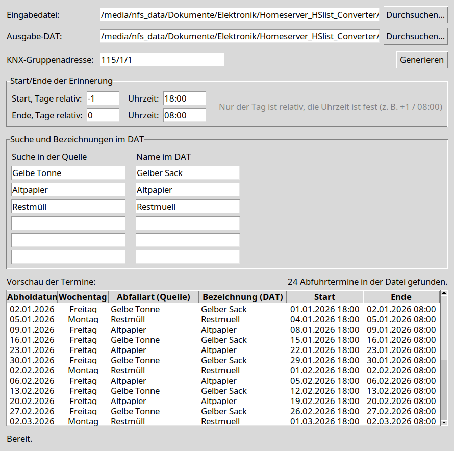

# HS_ExternalSwitchingList_Generator

A small Tkinter application that converts waste-collection schedules from
AbfallPlus CSV or ICS exports into a HomeServer switching-list `.dat` file.



The generated list contains one reminder entry and one end entry per collection
date:

```text
YYYYMMDD_HHMM|KNX_GROUP_ADDRESS|EVENT_NAME
YYYYMMDD_HHMM|KNX_GROUP_ADDRESS|-
```

A blank line is inserted between months.

## Features

- GUI and command-line interface
- CSV input with semicolon-separated columns
- ICS calendar input with `VEVENT` entries
- Preview of all matched collection dates before generating
- Configurable KNX group address
- Configurable start and end times relative to the collection date
- Editable source search terms and output event names
- Three optional additional search/name pairs
- Overwrite confirmation when the output file already exists
- Embedded trashcan window icon

## Requirements

- Python 3.10 or newer
- Tkinter (usually included with Python on Linux)

The application itself uses only the Python standard library. PyInstaller is
only needed to build a standalone executable or AppImage.

## Running

### AppImage

```bash
chmod +x HS_ExternalSwitchingList_Generator-x86_64.AppImage
./HS_ExternalSwitchingList_Generator-x86_64.AppImage
```

The AppImage requires a Linux x86_64 system. It can run from any directory; use
the file picker to select the input and output files. The included AppImage was
built on Ubuntu 24.04 with glibc 2.39; older distributions may need to run the
application from source instead.

### From source

```bash
python3 generate_muell_dat.py
```

Starting without arguments opens the GUI. Starting with arguments runs the CLI.

## Input formats

### CSV

The first row contains the column names, and dates use the format
`DD.MM.YYYY`. Columns are separated by semicolons.

Example:

```csv
Gelbe Tonne;Altpapier;Restmüll
02.01.2026;09.01.2026;18.01.2026
```

### ICS

Standard iCalendar files with `VEVENT` blocks are supported. The event
`SUMMARY` is used as the source name and `DTSTART` supplies the collection
date. This works with exports such as
`allestrassen2026.ics`.

## Default mappings

Source searches are case-insensitive and umlaut-insensitive substring matches.
They are applied to CSV column headers or ICS event summaries.

| Purpose | Default search | Default DAT name |
| --- | --- | --- |
| Yellow bag | `Gelbe Tonne` | `Gelber Sack` |
| Waste paper | `Altpapier` | `Altpapier` |
| Residual waste | `Restmüll` | `Restmuell` |

Three optional rows are available for additional event types, for example:

```bash
python3 generate_muell_dat.py allestrassen2026.ics \
  -o muell2026.dat \
  --extra1-search "Biomüll" \
  --extra1-name "Biomuell"
```

Each optional source search must be paired with an output name.

## Defaults

- KNX group address: `115/1/1`
- Start: one day before the collection date at `18:00`
- End: on the collection date at `08:00`
- Default input: `allestrassen2026.csv`
- Default output: `muell2026.dat`

## Command-line usage

```bash
python3 generate_muell_dat.py INPUT \
  -o OUTPUT \
  -k 115/1/1 \
  --start-days -1 \
  --start-time 18:00 \
  --end-days 0 \
  --end-time 08:00
```

Show all options:

```bash
python3 generate_muell_dat.py --help
```

## Building the AppImage

Install PyInstaller and build the standalone binary:

```bash
python3 -m venv .venv
.venv/bin/pip install pyinstaller
.venv/bin/pyinstaller --onefile --windowed \
  --name HS_ExternalSwitchingList_Generator \
  generate_muell_dat.py
```

The binary is written to `dist/HS_ExternalSwitchingList_Generator`. To create an
AppImage, place the binary in an AppDir together with `AppRun`, a desktop file,
and an icon, then package it with `appimagetool`.

## License

This project is licensed under the GNU General Public License version 3 only
(`GPL-3.0-only`). See [LICENSE](LICENSE) for the full license text.
